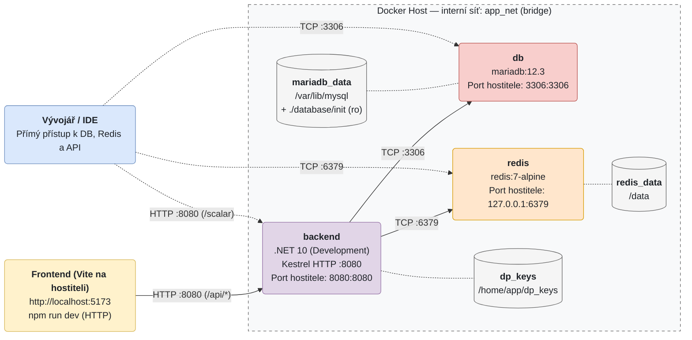
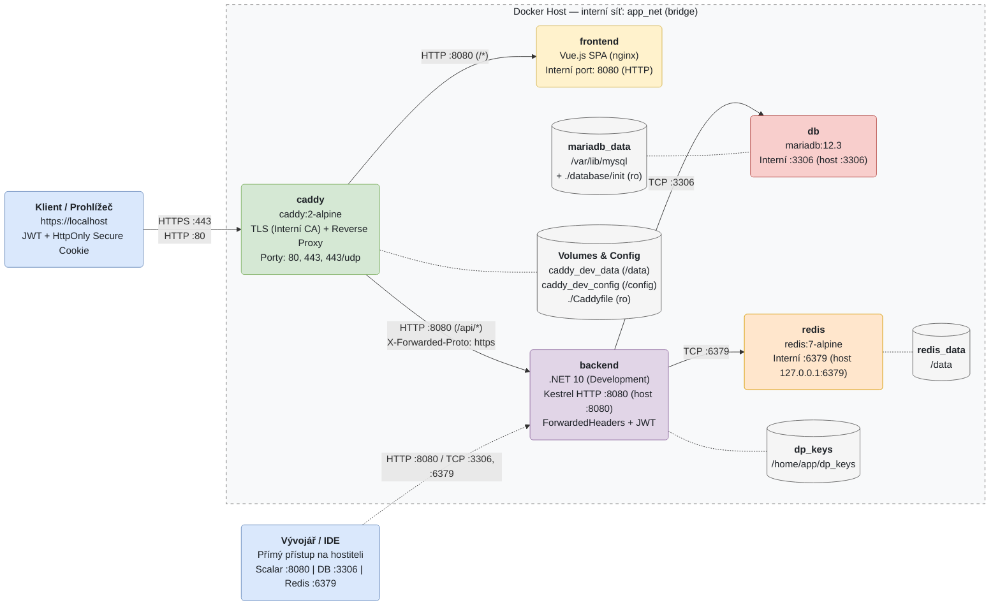
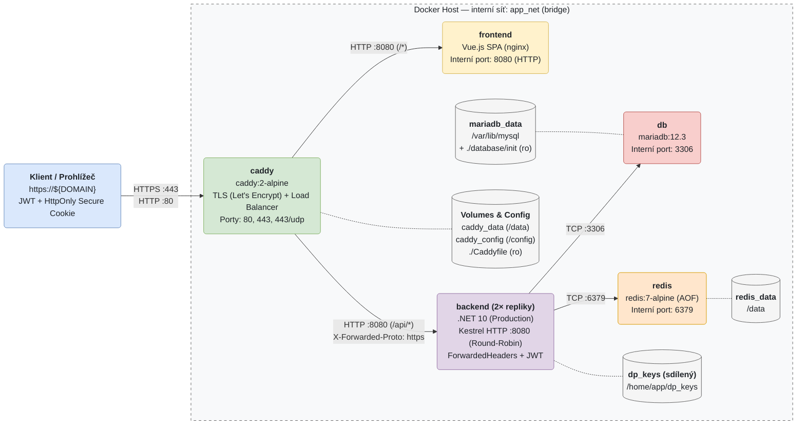

# NNPRO E-Learning System

E-learningová platforma postavená na **ASP.NET Core (.NET 10)**, **Vue.js (SPA)**, **MariaDB**, **Redis** a reverzní proxy **Caddy** běžící v Dockeru.

## 1. Architektura a přehled prostředí

Projekt je rozdělen do čtyř samostatných Docker Compose konfigurací podle účelu použití:

| Soubor | Účel | Spuštěné služby |
| :--- | :--- | :--- |
| `docker-compose.dev.backend.yaml` | Lokální vývoj frontendu (nebo jen DB + Redis pro IDE) | `db`, `redis`, `backend` (Development, HTTP) |
| `docker-compose.yaml` | Kompletní vývojový stack v Dockeru včetně HTTPS proxy | `caddy`, `frontend`, `backend` (Development), `db`, `redis` |
| `docker-compose.prod.local.yaml` | Lokální test kompletní produkční architektury | `caddy`, `frontend`, `backend` (2× Production), `db`, `redis` |
| `docker-compose.prod.yaml` | Ostré produkční nasazení na serveru (Azure) | `caddy`, `frontend`, `backend` (2× Production), `db`, `redis` |

### Síťová architektura a TLS

* **Jediný vstupní bod (Caddy):** V konfiguracích `docker-compose.yaml`, `docker-compose.prod.local.yaml` a `docker-compose.prod.yaml` vystavuje porty `80/tcp`, `443/tcp` a `443/udp` reverzní proxy **Caddy**. V produkci automaticky získává a obnovuje certifikáty od **Let's Encrypt**; při lokálním spuštění (`DOMAIN=localhost`) si automaticky generuje vlastní lokální certifikát přes interní CA.
* **Interní komunikace po HTTP:** Uvnitř privátní Docker sítě `app_net` komunikují služby čistě po HTTP (backend na portu `8080`) — v žádném Docker Compose prostředí není potřeba generovat ani připojovat `.pfx` certifikáty.
* **Load balancing:** V produkčních konfiguracích (`docker-compose.prod.yaml` a `docker-compose.prod.local.yaml`) Caddy rozkládá požadavky na `/api/*` (**round-robin**) mezi **2 repliky backendu**, zatímco ostatní cesty (`/*`) směruje na **Nginx** kontejner s Vue.js aplikací.

## 2. Prerekvizity a konfigurace prostředí

Všechny Docker příkazy spouštěj z kořene repozitáře. Před prvním lokálním spuštěním vytvoř konfigurační soubor z šablony:

```bash
cp .env.example .env
```

> **Poznámka k `.env` a `.env.prod`:** Soubory `.env` nepodporují interpolaci proměnných — pokud změníš `DB_PASSWORD`, nezapomeň stejné heslo aktualizovat také uvnitř `DOCKER_DB_CONNECTION_STRING` (`Password=...`). Podpisový klíč `JwtOptions__SecretKey` musí mít alespoň 64 znaků.

* **Vývoj v Dockeru bez certifikátů:** Pro spuštění `docker-compose.yaml` ani žádného ze souborů `docker-compose.*.yaml` není nutné vytvářet žádné SSL certifikáty.
* **Vývoj přímo na hostiteli (mimo Docker):** Frontend (`npm run dev`) běží lokálně čistě přes HTTP (`http://localhost:5173`) a nevyžaduje žádný certifikát. Kořenový `.env` obsahuje jak proměnné pro Docker (`DOCKER_DB_CONNECTION_STRING`, `REDIS_DOCKER_CONNECTION`), tak lokální `ConnectionStrings__*` na `127.0.0.1` pro běh backendu z IDE. Pokud spouštíš backend přímo z IDE přes HTTPS profil, vygeneruj si vývojový certifikát příkazem:
  ```bash
  dotnet dev-certs https --trust
  ```

## 3. Spuštění jednotlivých prostředí

> **Poznámka:** Při přepínání mezi různými režimy vždy nejprve ukonči předchozí stack (`docker compose down` nebo `docker compose -f <predchozi-soubor> down`), aby nedošlo ke kolizi portů nebo názvů kontejnerů.

### A) Lokální vývoj s backendem v Dockeru (`docker-compose.dev.backend.yaml`)

Spustí databázi, Redis a vývojový backend na HTTP portu `8080` (vhodné při lokálním spuštění frontendu přes `npm run dev` na `http://localhost:5173`):

```bash
docker compose -f docker-compose.dev.backend.yaml up -d --build
```

> **Pro vývoj backendu v IDE:** Pokud chceš spouštět a ladit samotný backend přímo z IDE, spusť jen databázi a Redis, aby nebyl obsazený port `8080`:
> ```bash
> docker compose -f docker-compose.dev.backend.yaml up -d db redis
> ```



### B) Kompletní vývojový stack (`docker-compose.yaml`)

Spustí celý stack včetně reverzní proxy Caddy (`https://localhost/`), Nginx frontendu a backendu v režimu `Development`:

```bash
docker compose up -d --build
```



### C) Lokální test produkčního stacku (`docker-compose.prod.local.yaml`)

Spustí kompletní produkční architekturu včetně Caddy, Nginx frontendu a 2 replik backendu v režimu `Production` na `https://localhost` (využívá lokální `.env`):

```bash
docker compose -f docker-compose.prod.local.yaml up -d --build
```


### D) Ostré produkční nasazení (`docker-compose.prod.yaml`)

1. Vytvoř produkční konfiguraci na serveru a vyplň reálnou doménu (`DOMAIN`), e-mail pro Let's Encrypt (`ACME_EMAIL`) a silná hesla/klíče (CORS origin `https://${DOMAIN}` se propisuje automaticky):
   ```bash
   cp .env.prod.example .env.prod
   ```
2. Ověř, že ve firewallu / Azure Network Security Group jsou otevřené příchozí porty **`80/tcp`**, **`443/tcp`** a **`443/udp`** a DNS záznam `DOMAIN` směřuje na IP adresu serveru.
3. Spusť produkční stack:
   ```bash
   docker compose -f docker-compose.prod.yaml --env-file .env.prod up -d --build
   ```



## 4. Dostupné služby a endpointy

### Vývojové prostředí (`docker-compose.yaml` a `docker-compose.dev.backend.yaml`)

* **Aplikace přes Caddy (pouze `docker-compose.yaml`):** `https://localhost/` (API na `https://localhost/api/...`)
* **Backend API (přímý přístup):** `http://localhost:8080/api/...` *(kořenová cesta `/` na portu `8080` nemá stránku, frontend běží přes Caddy na `https://localhost/`)*
* **OpenAPI JSON:** `http://localhost:8080/openapi/v1.json` *(pouze Development)*
* **Scalar dokumentace:** `http://localhost:8080/scalar` *(pouze Development)*
* **Health check:** `http://localhost:8080/health`
* **MariaDB:** `127.0.0.1:3306`
* **Redis:** `127.0.0.1:6379`

### Produkční prostředí (`docker-compose.prod.yaml` a `docker-compose.prod.local.yaml`)

* **Frontend (Vue.js SPA):** `https://localhost/` (lokálně) nebo `https://<DOMAIN>/` (produkce)
* **Backend API (Load Balanced):** `https://localhost/api/...` nebo `https://<DOMAIN>/api/...`
* Backend (`8080`), databáze ani Redis nejsou vystaveny mimo interní síť `app_net`.

## 5. Autentizace a správa relací

Backend využívá krátkodobé JWT access tokeny (výchozí platnost 10 minut) a dlouhodobé refresh tokeny (1 den). Hodnoty lze upravit v `appsettings.json`. Podpisový klíč a identita tokenu se konfigurují přes proměnné prostředí (`JwtOptions__SecretKey`, `JwtOptions__Issuer`, `JwtOptions__Audience`). Podpisový klíč musí mít z bezpečnostních důvodů alespoň 64 znaků.

### Auth API Endpointy

| Metoda | Endpoint | Účel |
| :--- | :--- | :--- |
| `POST` | `/api/auth/register` | Registrace nového účtu (heslo min. 8 znaků). |
| `POST` | `/api/auth/login` | Přihlášení přes uživatelské jméno nebo e-mail a heslo. Pokud při loginu pošleš dosavadní access token jako Bearer, jeho relace se po úspěšném loginu ukončí. |
| `POST` | `/api/auth/refresh` | Obnova access tokenu a rotace refresh cookie; tělo požadavku se neposílá. |
| `POST` | `/api/auth/logout` | Odhlášení aktuální relace. |

### Integrace s frontendem a bezpečnost

Access token backend vrací v JSON pod `data.accessToken`. Frontend ho drží pouze v paměti a posílá jako Bearer token:

```javascript
headers: { Authorization: `Bearer ${accessToken}` }
```

Refresh token backend nastavuje jako `HttpOnly; Secure; SameSite=Lax` cookie s cestou `/api/auth`; v databázi uchovává pouze jeho hash. JavaScript cookie nepřečte. U *cross-origin* požadavků použij ve `fetch` `credentials: "include"`, v Axiosu `withCredentials: true` (login, registrace, refresh i logout). CORS povoluje credentials jen nakonfigurovaným originům.

Po obnovení stránky frontend zavolá `/api/auth/refresh` a access token uloží z odpovědi. Při `401` z chráněného API může frontend jednou obnovit token a původní požadavek zopakovat; pokud refresh vrátí `401`, musí uživatele odhlásit. Refresh endpoint vyžaduje hlavičku `Origin` odpovídající nakonfigurovanému originu nebo originu samotného API.

Refresh tokeny se při obnově rotují. Opětovné použití spotřebovaného tokenu zneplatní jeho tokenovou rodinu (konkrétní relaci), ne ostatní relace uživatele. Access tokeny se při revokaci blokují v Redis do konce jejich platnosti.

Cookie s `SameSite=Lax` funguje pro frontend a API na stejné doméně/`site` (v produkci i v `docker-compose.yaml` běží obojí pod jednou originou `https://<DOMAIN>` / `https://localhost` přes Caddy; při lokálním vývoji přes Vite na `http://localhost:5173` proti portu `8080` jde stále o stejný `site` `localhost` a moderní prohlížeče považují `localhost` za důvěryhodný kontext i pro `Secure` cookies). Pro *cross-origin* vývoj je potřeba povolit přesný origin frontendu v `CorsSettings:AllowedOrigins`.

### Administrátorské funkce (Role: Admin)

Administrátoři mohou spravovat relace uživatelů:

* `GET /api/admin/users/{userId}/sessions` – Výpis všech aktivních relací uživatele.
* `DELETE /api/admin/users/{userId}/sessions/{sessionId}` – Ukončení jedné konkrétní relace (`sessionId` odpovídá ID rodiny tokenů z výpisu).
* `DELETE /api/admin/users/{userId}/sessions` – Okamžité odhlášení uživatele ze všech zařízení.

### Vývojové prostředí (Seeding)

Při spuštění v režimu `Development` se automaticky vytvoří testovací účty (`admin/admin`, `student/student`, `instructor/instructor`, `student2/student2`, `instructor2/instructor2`) a ukázkové kurzy. Tento seed se v produkčním prostředí nespouští.

## 6. Důležité poznámky pro vývojáře a provoz

* **Automatické EF Core migrace a bezpečný seeding:** Databázové schéma se aplikuje automaticky při startu backendu (`dbContext.Database.MigrateAsync()`). Souběžný start více replik je chráněn databázovým zámkem tabulky `__EFMigrationsHistory` (u migrací) a databázovým advisory lockem `GET_LOCK` s transakcí v `DbInitializer` (u vývojového seedu).
* **Bezstavový backend (2 repliky):** Obě produkční repliky backendu sdílejí volume `dp_keys` (pro DataProtection klíče) a veškerý sdílený stav ukládají do **Redis** a **MariaDB**.
* **MariaDB verze:** Databáze používá příznak `MARIADB_AUTO_UPGRADE=1` pro bezproblémové aktualizace systémových tabulek databáze.
* **Lokální self-signed certifikát v prohlížeči:** Při lokálním spuštění přes Caddy (`docker-compose.yaml` nebo `docker-compose.prod.local.yaml` na `https://localhost`) prohlížeč zobrazí varování před lokálním certifikátem vygenerovaným Caddy — stačí potvrdit pokračování na stránku (případně lze v Chrome/Edge zapnout `chrome://flags/#allow-insecure-localhost`).
* **Git:** Soubory `.env` a `.env.prod` obsahují citlivé údaje a nesmí být součástí Git repozitáře.